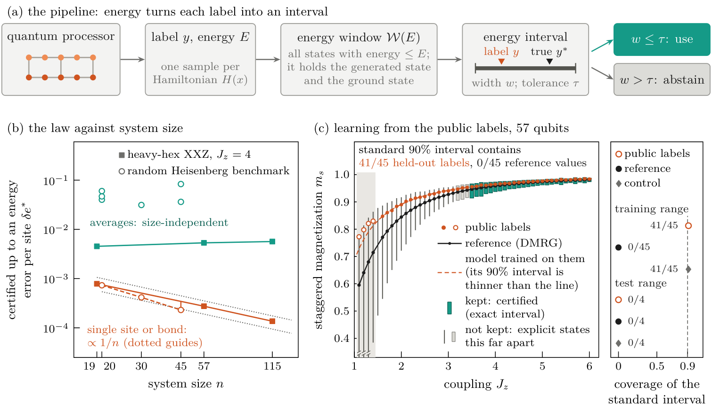
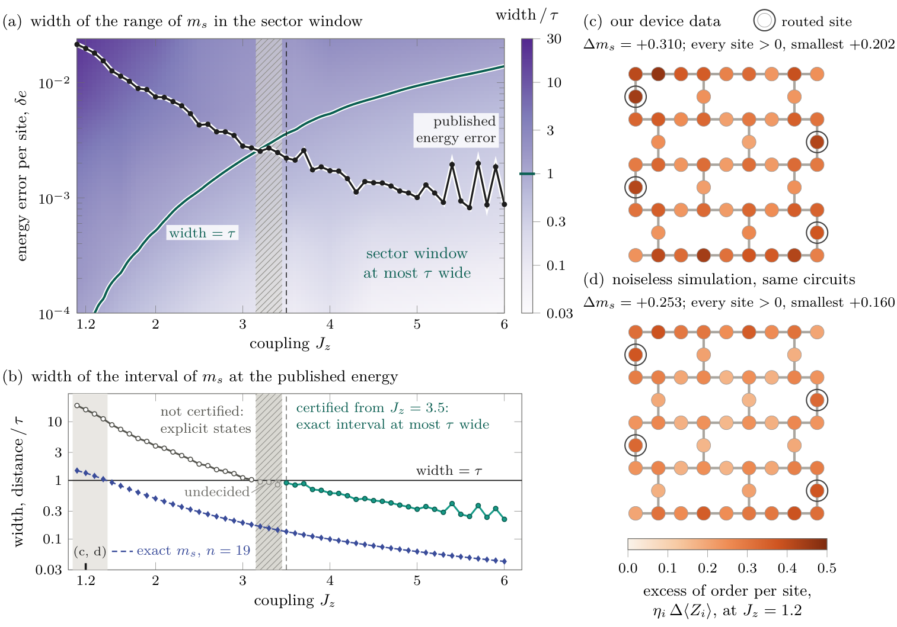
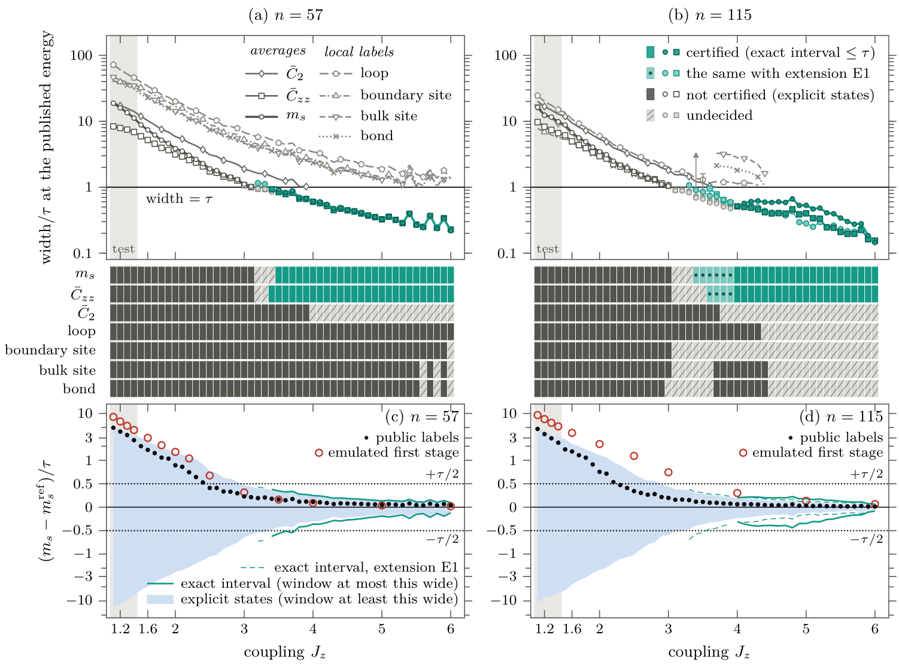
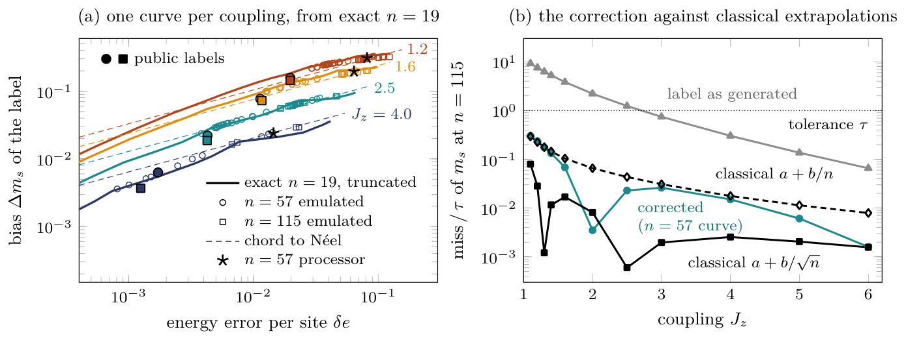

<div align="center">

# What a sample's energy certifies about quantum-generated training labels
### *replication package: data, code, certificates and manuscript sources*

**Nicolás Bonilla Vargas** &nbsp;[](https://orcid.org/0009-0006-6155-4391)<br>
Universidad Nacional de Colombia, Bogotá, Colombia · SRH University, Munich, Germany · Daita AI, Munich, Germany

[](CITATION.cff)
[](LICENSE)
[](LICENSE)
[](requirements.txt)

</div>

> **Status.** Version 1.0.0 of this package accompanies the manuscript *What a sample's energy certifies about quantum-generated training labels* ([`paper/main.pdf`](paper/main.pdf),
> Supplemental Material [`paper/supplement.pdf`](paper/supplement.pdf)). Repository: <https://github.com/nicolasbonilla/energy-certified-quantum-labels>. The article is not on arXiv yet. The archived copy at Zenodo is made from the releases of this repository; its identifier is added here as soon as it exists.
> Every number printed in the two documents carries a comment that names the stored file it comes from, and a
> script re-checks them ([Quick start](#quick-start)).

## Abstract of the article

> Quantum processors now supply training labels for machine learning of quantum matter; each sample's energy is a scalable quality check. We determine, label by label, what any energy-only certificate can guarantee and the accuracy it requires. A label stays certifiable at large size exactly when shifting it costs energy linear in size: local labels lose certification beyond a size inversely proportional to the energy error per site; averages keep it under a uniform-gap hypothesis. For the model of a public 57- and 115-qubit dataset we prove the hypothesis at strong anisotropy, above a threshold that is not explicit; in the dataset's range it remains a hypothesis. The published energy and site magnetizations, taken as those of one state, certify in exact arithmetic, with no reference value, the order parameter to 6% at 26 of 45 training couplings at 57 qubits and 21 at 115 (27 with certificates added afterwards), where an exact 19-site calculation is within 1.3% of the reference. Near the isotropic point, where the test couplings lie, the order parameter needs an energy error more than 110 times smaller at 57 qubits (79 at 115); explicit states show that no analysed label is certified. The public labels are over-ordered there; at 57 qubits a cubic model trained on them inherits the bias: its standard prediction intervals contain 41 of 45 held-out labels but the authors' reference value at none (11 of 45 at 115). Intervals calibrated on the 18 labels certified to half the tolerance stay below the tolerance and contain the reference value, which varies little there, in all 200 splits, also for a control trained on uncertified labels; with all certified labels they mostly exceed it. One processor point of ours is certified with no reference value, where a classical energy does better. We propose that datasets report each label's interval width alongside the best classical estimate.

The dataset studied is that of Jaderberg *et al.*, [arXiv:2606.15983](https://arxiv.org/abs/2606.15983);
its labels, energies and reference values are public in the authors' repository
(<https://github.com/bjader/quantum-groundstate-learning>, commit `6b8866b`, Apache-2.0). This package holds a converted copy of those data with
checksums. The pinned archive of that repository and text copies of its code files are redistributed in `phase3/full_runs/real_data/source/` under its Apache-2.0 licence (this is a choice made when the package is built: `build_release.py --no-upstream-archive` leaves them out).

---

## The figures of the article

The four figures of the main text, as previews. The captions are short forms of those in the article; τ is the
tolerance (6% of the reference value of the label), J<sub>z</sub> the coupling, m<sub>s</sub> the order parameter
and *n* the number of qubits. Every figure of the Supplemental Material is in [`docs/FIGURES.md`](docs/FIGURES.md);
the vector files are in [`paper/figures/`](paper/figures/), and how each one is made from the stored data is in
[Figures: file → script → data](#figures-file--script--data).

<p align="center"></p>

**Figure 1. What energy certifies, and what a learner can guarantee.** (a) A label's energy fixes an interval that
contains the label and its true value; the label is used only if that interval is at most τ wide. (b) The largest
energy error per site at which a label stays certified: flat for averages, falling as 1/*n* for single sites and
bonds. (c) The public labels of the 57-qubit dataset: a cubic model trained on the 45 training labels follows the
labels, not the reference, and misses the reference by 2.28–3.73 τ at the four test couplings (shaded). Teal bars:
the exact intervals of the 26 labels kept by the energy filter; grey bars: labels not kept.

<p align="center"></p>

**Figure 2. What a sample's energy certifies, and what the first stage of the method class does inside the window
(*n* = 57).** (a) The range of m<sub>s</sub> allowed by the energy, over the coupling and the energy error per site;
below the teal line the window is at most τ wide. Black line: the published energy error of the dataset at each of
its 50 couplings. (b) The width of the interval at the published energy: certified (teal), not certified (dark grey),
undecided (light grey). (c) Our own device data of the first stage of the method class at J<sub>z</sub> = 1.2: the
excess of order is positive at all 57 sites. (d) Noiseless simulation of the identical circuits.

<p align="center"></p>

**Figure 3. The certification map at the published energies, and the public labels inside it.** (a, b) Width of
each label's interval at the published energy, in units of τ, at every coupling of the dataset: filled symbols
certified (exact interval), open symbols not certified (two explicit states of the window), light grey undecided.
The order parameter is certified at 26 of the 45 training couplings at *n* = 57 and at 21 at *n* = 115 (27 with the
certificates added afterwards); at the four test couplings (shaded) all seven labels are not certified. (c, d) The
public labels (dots) lie above the reference at every coupling of both sizes, and inside the exact interval wherever
one exists. Every certified status rests on the hypothesis that the published energy and labels of a sample belong
to one state.

<p align="center"></p>

**Figure 4. The bias against the energy (exploratory data, with the public labels added).** (a) Bias of
m<sub>s</sub> against the energy error per site at four couplings: exact ground state at *n* = 19 truncated to its
most probable configurations (solid), a parameter-free chord (dashed), stored emulated states (open symbols), our
device labels (stars), the public labels (filled). The declared test of the curve on the public labels fails at
*n* = 115. (b) The emulated label at *n* = 115, as generated, corrected with the curve of the *n* = 57 emulation,
and two classical extrapolations that use no quantum data.

## What the package reproduces

| Level | What you can re-run on a laptop | Command | Time (laptop, 2 threads) |
|---|---|---|---|
| Numbers | Every number printed in `main.tex` and `supplement.tex` against the stored file named in its `% src:` comment. Recorded when the package was built: main text 897 numbers, 0 `MISSING`; Supplement 4323 numbers, 0 `MISSING`. | `python run_checks.py numbers` | seconds |
| Certificates | The 316 stored certificates are operator inequalities with rational coefficients. A verifier written as separate code (it imports neither the optimizer nor the stored verifier) re-proves each one in exact arithmetic (operator identity and positivity of every block). A sample of 5 by default, all with `--all`. | `python run_checks.py certificates` | about 1 minute for the sample |
| Map on the public data | The declared map code is run again on the converted public data, the stored certificates and the stored states, into a temporary folder; its six outputs are compared with the stored ones by SHA-256 (see the note on comparisons below). | `python run_checks.py map` | about 5 minutes |
| Bias | The declared tests of the sign, trend and size of the bias of the public labels. | `python run_checks.py bias` | seconds |
| Learning | The cheap stage of the learning tests: cubic model with standard conformal intervals, Proposition 2, the floor, and the constructive test on 200 seeded splits. | `python run_checks.py learning` | about 1.5 minutes |
| Documents | `pdflatex` + `bibtex` of the article, the Supplement and the ancillary tables. | `python run_checks.py pdf` | about 1 minute |
| Figures and tables | Each figure folder has an export script that reads the stored outputs and writes the plotted data, and a TeX source; the generated tables of the Supplement are written by `paper/figures/sm_tables/make_rd*.py` and `paper/figures/make_sm_*.py`. | see [Figures](#figures-file--script--data) | seconds each |

**Not re-run here, and why.** The DMRG reference states, the search for the certificates (a semidefinite relaxation
followed by exact rounding), the emulation of the generating method and the neural models ran on cloud virtual
machines for hours; the device data come from a quantum processor. Their code, written protocols and stored
outputs are in the run folders (the per-job logs and the duplicate copies fetched from the cloud machine are not:
[`docs/LEFT_OUT.md`](docs/LEFT_OUT.md)), so each stored output can be inspected and each certificate re-proved, but this
package does not re-compute them. `run_checks.py` compares re-computed outputs with stored ones; it does not check
any sentence of the article. Details: [`docs/LEFT_OUT.md`](docs/LEFT_OUT.md).

## Quick start

```bash
python -m venv .venv && source .venv/bin/activate      # Windows: .venv\Scripts\activate
pip install -r requirements.txt                        # numpy and scipy are enough for the first five steps

python run_checks.py numbers        # the guardian on both documents; expected: 0 MISSING
python run_checks.py certificates   # exact verification of 5 certificates (--all: every one, about 20 minutes)
python run_checks.py map            # the declared map code, compared with the stored outputs by SHA-256
python run_checks.py bias learning  # tests of the bias and the cheap stage of the learning tests, compared
python run_checks.py pdf            # the three PDFs (needs pdflatex and bibtex with REVTeX 4.2 and pgfplots)
python run_checks.py                # everything above
python run_checks.py --all          # everything above with every one of the 316 certificates: about half an hour
```

**How outputs are compared.** A re-computed output is compared with the stored one byte for byte (SHA-256); on the
machine where the package was built every output is reproduced that way. Another processor or numerical library
changes the last digits of a floating-point result, so if the bytes differ the two files are compared entry by
entry: integers, words and structure must be identical and decimal numbers must agree to a relative 1e-9. Such a
file is reported as passed with that note, and the summary lists it on a line of its own.

`run_checks.py` runs on Windows, Linux and macOS and writes only into a temporary folder (`--tmp DIR --keep` to choose
and keep it). A `Makefile` with the same steps is provided for convenience (`make help`). The code that reads the
public data refuses to run unless `phase3/full_runs/real_data/DECLARATION.sha256` holds the SHA-256 of
`DECLARATION.md`: the analysis was declared before it was run, and the rule is kept in the package.

**Scripts that name the author's folder.** 21 scripts hold the folder of the author's machine in a
line of code, usually one line `ROOT = "..."` at the top: the checks written during review (`paper/reviews/`),
the audits of `phase3/full_runs/real_data/checks/` and one script that writes result tables. They are stored
byte for byte as they ran; to run one, set that line to the folder of this package. The list is
[`docs/SCRIPTS_WITH_MACHINE_PATHS.tsv`](docs/SCRIPTS_WITH_MACHINE_PATHS.tsv). No script that `run_checks.py` calls is
among them: the declared code finds its files from its own location.

## Layout

The package keeps the folder layout of the author's working tree, so that every path written in a source comment,
in a script or in a written protocol resolves as it stands.

```
.
├── paper/
│   ├── main.tex, supplement.tex, tables.tex, references.bib      the article, its Supplement, the ancillary tables
│   ├── main.pdf, supplement.pdf, tables.pdf                      compiled copies
│   ├── check_numbers.py                                          the guardian: every printed number against its source
│   ├── check_numbers_output_main.txt, ..._supplement.txt         its two reports, made inside this package
│   ├── check_hidden_text.py, check_overlap.py    form checks of the manuscript
│   ├── figures/                                                  compiled figures, pgf_*/ source folders, table scripts
│   │   ├── preview/                                              PNG previews of every figure, and the script that makes them
│   │   └── sm_tables/                                            generated tables of the Supplement and make_rd*.py
│   ├── data/r3gen/, data/crosschecks/                            exact-diagonalization checks of the theorems
│   └── reviews/R10_2026-11-12/                                   only: outputs cited as sources, their scripts, and the
│                                                                 theory scripts named in the Supplement
├── phase3/
│   ├── full_runs/real_data/                                      the public data and the declared analysis (below)
│   ├── full_runs/{map,rigor,method,qpu,final_tests,learning,learning_ibm,huang,bias_law,kill_tests/W_window}/
│   └── design/*.md, STEP0_*.md                                   derivations cited by source comments
├── docs/
│   ├── NUMBERS_TO_FILES.tsv                                      every stored file cited, and the lines that cite it
│   ├── HEADLINE_NUMBERS.tsv                                      the numbers of the abstract: file and key
│   ├── CERTIFICATES.tsv, EXPECTED.json                           list of certificates; counts recorded at build time
│   ├── SCRIPTS_WITH_MACHINE_PATHS.tsv                            scripts with the author's folder in a line of code
│   ├── FIGURES.md                                                every figure of the article, the Supplement and the tables
│   ├── LEFT_OUT.md                                               what is not in the package and how to get it back
│   └── MANIFEST.tsv                                              path, size and SHA-256 of every file
├── run_checks.py · Makefile · requirements.txt
└── README.md · LICENSE · NOTICE · CITATION.cff · .zenodo.json
```

`phase3/full_runs/real_data/` in more detail:

| Path | Content |
|---|---|
| `DECLARATION.md`, `DECLARATION.sha256`, `DECLARATION_hash_time.txt` | the analysis as declared, its checksum, and the time of the laptop's clock when it was computed (not an external time stamp) |
| `DEVIATIONS.md`, `RESULTS.md` (Part 0 is the audited summary) | what departed from the declaration; the results |
| `source/` | the pinned archive of the dataset's repository, its licence, the list of its files with checksums, text copies of its code |
| `converted/` | the public data as plain JSON (`real_n57.json`, `real_n115.json`, `lattice_maps.json`), conversion log, checksums |
| `code/` | converter, map code (`run_map.py`), tests of the bias (`run_predict.py`), learning tests (`run_learn.py`); `README.md` and `README_predict_learn.md` describe every file |
| `out/` | outputs of the declared analysis: `map_rows.json` (one row per size, coupling and label), `map_summary.json`, `S_sets.json`, `predict_real.json`, `learn_real.json`, `learn/` |
| `checks/` | independent recomputations (audits), the second run of the converter, descriptive checks |
| `e1/` | certificates computed after the declaration (a separate column, never mixed with the declared sets): specification, code, `certs/`, the map with that column (`map_e1/`), the learning run on the extended sets (`learn_e1/`) |
| `results/`, `tests/` | result tables as text with the scripts that wrote them; unit tests on synthetic data |

## Figures: file → script → data

Every plotted number is read from a stored file by the export script of its folder; `export_check.txt` in each
folder lists the assertions the script ran. To rebuild a figure: `python -B <export script>`, then
`python -B build_rd.py <name>` (or `build.py`) in the same folder, which runs pdflatex. The scripts write next to
themselves. The older scripts (`paper/figures/make_sm_*.py`, `make_table1.py` and the export scripts of the
`pgf_sm_*`, `pgf_overview` and `pgf_composite` folders) import modules that lie next to them or one folder up, so
run them from their own folder and without Python's isolated mode (`-I` hides the script's folder).

| Figure file (document) | Folder: export script, then TeX source | Data read (under `phase3/full_runs/` unless stated) |
|---|---|---|
| `paper/figures/fig1_overview_rd_pgf.pdf` (main) | `paper/figures/pgf_overview_rd/`: `export_overview_rd.py`, then `fig_overview_rd.tex` | real_data/out/learn/results_cheap.json; real_data/out/map_rows.json; panel (b): b_*.dat of paper/figures/pgf_overview/ (map/laptop_analysis/summary_map.json, huang/laptop_analysis/summary_huang.json) |
| `paper/figures/fig1_composite_rd_pgf.pdf` (main) | `paper/figures/pgf_composite_rd/`: `export_composite_rd.py`, then `fig_composite_rd.tex` | real_data/out/map_rows.json; real_data/out/predict_real.json; map and device panels: files of paper/figures/pgf_composite/ (map/laptop_analysis/, qpu/) |
| `paper/figures/fig1_map_rd_pgf.pdf` (main) | `paper/figures/pgf_map_rd/`: `export_map_rd.py`, then `fig_map_rd.tex` | real_data/out/map_rows.json; real_data/e1/map_e1/map_rows.json; method/laptop_post/out/emu/emu_n*_J*.json |
| `paper/figures/fig_bias_law_rd.pdf` (main) | `paper/figures/pgf_biaslaw_rd/`: `export_biaslaw_rd.py`, then `fig_bias_law_rd.tex` | real_data/out/predict_real.json; real_data/out/map_rows.json; paper/figures/data_biaslaw/*.dat (bias_law/code/bias_law.py) |
| `paper/figures/figS_landscape_n57_pgf.pdf` (supplement) | `paper/figures/pgf_sm_3d/`: `export_sm3d.py`, then `figS_landscape_n57_pgf.tex` | map/laptop_analysis/out/states/, out/thr/, summary_map.json; method/laptop_post/out/emu/, out/summary.json |
| `paper/figures/figS_lattice_pgf.pdf` (supplement) | `paper/figures/pgf_sm_3d/`: `export_sm3d.py`, then `figS_lattice_pgf.tex` | method/laptop_post/out/emu/emu_n*_J1.2.json, out/ref/ref_n*_J1.2.json; map/laptop_analysis/out/states/, summary_map.json |
| `paper/figures/figS1_bias_vs_ratio_pgf.pdf` (supplement) | `paper/figures/pgf_sm_method/`: `export_sm_method.py`, then `fig_bias_ratio.tex` | method/laptop_post/out/summary.json |
| `paper/figures/figS_learning_pgf.pdf` (supplement) | `paper/figures/pgf_sm_learning/`: `export_sm.py`, then `figS_learning_pgf.tex` | learning/analysis/learn_M1_D_O.json, learn_M2_D_O.json |
| `paper/figures/figS_huang_pgf.pdf` (supplement) | `paper/figures/pgf_sm_learning/`: `export_sm.py`, then `figS_huang_pgf.tex` | huang/laptop_analysis/summary_huang.json |
| `paper/figures/fig2_rule_pgf.pdf` (supplement) | `paper/figures/pgf_sm_method/`: `export_sm_method.py`, then `fig_rule.tex` | paper/data/r3gen/out/t2_local.txt, t3_comb.txt; map/laptop_analysis/summary_map.json |
| `paper/figures/fig3_mechanism_pgf.pdf` (supplement) | `paper/figures/pgf_sm_method/`: `export_sm_method.py`, then `fig_mechanism.tex` | method/laptop_post/out/summary.json, out/gsscan/*.json |
| `paper/figures/figS_landscape_n115_pgf.pdf` (tables) | `paper/figures/pgf_sm_3d/`: `export_sm3d.py`, then `figS_landscape_n115_pgf.tex` | as figS_landscape_n57_pgf, n = 115 |
| `paper/figures/figS_lattice_n115_pgf.pdf` (tables) | `paper/figures/pgf_sm_3d/`: `export_sm3d.py`, then `figS_lattice_n115_pgf.tex` | as figS_lattice_pgf, n = 115 |

Generated tables of the Supplement (`paper/figures/sm_tables/*.tex`): `make_rdmap.py`, `make_rdtest.py` and
`make_rdlearn.py` in that folder for the tables on the public data, and `paper/figures/make_sm_*.py`,
`make_table1.py` for the others; each script names its inputs in its header. Longer notes:
[`paper/figures/FIGURES_README_rd.md`](paper/figures/FIGURES_README_rd.md) and
[`paper/figures/FIGURES_README.md`](paper/figures/FIGURES_README.md).

## Headline numbers: number → file → key

The numbers of the abstract of `paper/main.tex`, in the order printed. The verdict is the one of the guardian's
report made inside this package (`paper/check_numbers_output_main.txt`): `PATH` = equal, at the printed precision, to
the value at that key of the stored JSON file; `STRING` = the printed string occurs in the cited file; `CONTEXT` = a
constant of the model (sizes, number of training couplings); `UNCHECKED` = arithmetic on cited values or a reading
of a published figure, reported and not checked by the script. This table is generated from that report and from the
source comments; the same information for every line of both documents is in the two report files, and
[`docs/NUMBERS_TO_FILES.tsv`](docs/NUMBERS_TO_FILES.tsv) lists the 169 stored files that the comments name.

| Line of `main.tex` | Printed | In the sentence | Guardian | Stored file | Key |
|---|---|---|---|---|---|
| 55 | `57` | …57 - and 115 -qubit dataset we prove th… | STRING | `phase3/full_runs/real_data/DECLARATION.md` | (the printed string occurs in the file) |
| 55 | `115` | …57 - and 115 -qubit dataset we prove the hypothesi… | STRING | `phase3/full_runs/real_data/DECLARATION.md` | (the printed string occurs in the file) |
| 57 | `6` | …erence value, the order parameter to 6 % at 26 of… | STRING | `phase3/full_runs/real_data/DECLARATION.md` | (the printed string occurs in the file) |
| 57 | `26` | …lue, the order parameter to 6 % at 26 of… | PATH | `phase3/full_runs/real_data/out/map_summary.json` | `jstar.57_m_s.sec2` |
| 58 | `45` | …45 training couplings at 57 qubits an… | CONTEXT |  | (a constant of the model: size, number of training couplings, or a coupling of the grid) |
| 58 | `57` | …45 training couplings at 57 qubits and 21 at 115 ( 27 with… | CONTEXT |  | (a constant of the model: size, number of training couplings, or a coupling of the grid) |
| 58 | `21` | …raining couplings at 57 qubits and 21 at 115 ( 27 with certificates add… | PATH | `phase3/full_runs/real_data/out/map_summary.json` | `jstar.115_m_s.sec2` |
| 58 | `115` | …couplings at 57 qubits and 21 at 115 ( 27 with certificates added afterw… | CONTEXT |  | (a constant of the model: size, number of training couplings, or a coupling of the grid) |
| 58 | `27` | …gs at 57 qubits and 21 at 115 ( 27 with certificates added afterwards),… | PATH | `phase3/full_runs/real_data/e1/map_e1/map_summary.json` | `jstar.115_m_s.sec2_e1` |
| 59 | `19` | …19 -site calculation is within 1.3 % o… | STRING | `phase3/full_runs/real_data/checks/r11/fn_abstract_n19_percent_out.txt` | (the printed string occurs in the file) |
| 59 | `1.3` | …19 -site calculation is within 1.3 % of the reference. Near the… | STRING | `phase3/full_runs/real_data/checks/r11/fn_abstract_n19_percent_out.txt` | (the printed string occurs in the file) |
| 60 | `110` | …eter needs an energy error more than 110 times… | PATH | `phase3/full_runs/real_data/out/map_summary.json` | `accuracy_factors.57.m_s.headline_F_A` |
| 61 | `57` | …smaller at 57 qubits ( 79 at 115 ); explicit sta… | CONTEXT |  | (a constant of the model: size, number of training couplings, or a coupling of the grid) |
| 61 | `79` | …smaller at 57 qubits ( 79 at 115 ); explicit states show that… | PATH | `phase3/full_runs/real_data/out/map_summary.json` | `accuracy_factors.115.m_s.headline_F_A` |
| 61 | `115` | …smaller at 57 qubits ( 79 at 115 ); explicit states show that no analy… | CONTEXT |  | (a constant of the model: size, number of training couplings, or a coupling of the grid) |
| 62 | `57` | …labels are over-ordered there; at 57 qubits a cubic model trained on them… | STRING | `phase3/full_runs/real_data/DECLARATION.md` | (the printed string occurs in the file) |
| 63 | `41` | …prediction intervals contain 41 of 45 held-out labels but the auth… | PATH | `phase3/full_runs/real_data/out/learn_real.json` | `summary.57.models.poly3_invJ.real.ind.label_covered` |
| 63 | `45` | …prediction intervals contain 41 of 45 held-out labels but the authors' ref… | CONTEXT |  | (a constant of the model: size, number of training couplings, or a coupling of the grid) |
| 63 | `11` | …he authors' reference value at none ( 11 of 45… | PATH | `phase3/full_runs/real_data/out/learn_real.json` | `summary.115.models.poly3_invJ.real.ind.truth_covered` |
| 63 | `45` | …prediction intervals contain 41 of 45 held-out labels but the authors' ref… | CONTEXT |  | (a constant of the model: size, number of training couplings, or a coupling of the grid) |
| 64 | `115` | …at 115 ). Intervals calibrated on the 18 l… | STRING | `phase3/full_runs/real_data/DECLARATION.md` | (the printed string occurs in the file) |
| 64 | `18` | …115 ). Intervals calibrated on the 18 labels certified to half the toleran… | PATH | `phase3/full_runs/real_data/out/learn_real.json` | `summary.57.f3.sets.S_1_2.size` |
| 65 | `200` | …e, which varies little there, in all 200 splits, also for a control trained o… | PATH | `phase3/full_runs/real_data/out/learn_real.json` | `summary.57.f3.sets.S_1_2.models.M1.n_splits_W` |

The aliases used in the source comments (`rdq:`, `rdl:`, `map:` ...) are defined in the dictionary `P` at the top of
`paper/check_numbers.py`.

## How to verify the certificates

A certificate is a file `*_cert.json`: rational multipliers such that a sum of cluster operators equals the
Hamiltonian plus a multiple of the total magnetization, each cluster operator being bounded below by a rational
number. It proves a lower bound on an energy, from which the bound on a label follows; it does not depend on any
measured energy. Two verifiers are in the package:

- `paper/reviews/R10_2026-11-12/scratch/math-rigorous-bounds/myverify.py`, written during review as separate code:
  it shares only the file format of the certificates with the stored verifier and imports neither that verifier nor
  the optimizer. It checks the operator identity on the full space and the positivity of every block, in integer
  and rational arithmetic (the factorization in floating point is only a witness; the residual is computed exactly).
  This is the one `run_checks.py certificates` uses: about 5 to 40 seconds per certificate.
- `phase3/full_runs/rigor/code/verify_exact.py`, the verifier that ran with the optimizer (fraction-free
  elimination in pure Python integers; its stored records give about 13 minutes for a certificate of the 57-site
  graph with nine-site clusters): `python run_checks.py certificates --verifier stored`.

```bash
python run_checks.py certificates              # 5 certificates, evenly spaced in docs/CERTIFICATES.tsv
python run_checks.py certificates --sample 20
python run_checks.py certificates --all        # every certificate (316 of them; about 20 minutes on a laptop)
```

Each stored certificate has its verification record next to it (`*_ver.json`); the step also compares the bound it
proves with that record. The map step below re-proves, in addition, the certificates that decide a row
(17 in the stored run).

## How to rebuild the map on the public data

```bash
python run_checks.py map
# or directly:
python -B -I phase3/full_runs/real_data/code/run_map.py --out <an empty folder>
```

The code reads `real_data/converted/` (after checking the checksum of the declaration and of the three data files),
the certificates of `rigor/`, `final_tests/` and `real_data/e1/`, and the stored states and thresholds of `map/`.
It writes `S_sets.json`, `map_rows.json`, `map_summary.json`, `map_secondary.json`, `map_gates.json` and
`map_tables.md`. Because the certificates of `e1/` are present, the outputs to compare with are those of
`real_data/e1/map_e1/` (the declared map plus the separate column of the certificates added afterwards); the
outputs of the declared run itself, made before those certificates existed, are in `real_data/out/`.
`S_sets.json`, `map_summary.json` and `map_tables.md` are compared byte for byte. `map_rows.json` and
`map_secondary.json` record the full path of each certificate file, and `map_gates.json` the run time of each
re-proof, so these three are compared after the folder of the package is written as a placeholder (and, for the
last, without the run times); the script says which comparison each file passed.
`--g1-rerun` also runs the converter again on the pinned archive (it needs the archive in `real_data/source/archive/`).

## How to re-run the tests of the bias and the learning tests

```bash
python run_checks.py bias learning
# or directly (H = the 64 hexadecimal digits in phase3/full_runs/real_data/DECLARATION.sha256):
python -B -I phase3/full_runs/real_data/code/run_predict.py --hash=H --out=<folder>
python -B -I phase3/full_runs/real_data/code/run_learn.py   --hash=H --stage=cheap --out=<folder>
```

The seed of every random choice is taken from the checksum of the declaration, so the 200 splits of the constructive
test are the same on every machine. Four of the five output files of the cheap stage are compared byte for byte;
`results_cheap.json` also records how long each model took, and is compared without those five times. The cheap stage covers the cubic model, the nearest-neighbour control, Proposition 2,
the floor and the constructive test. The neural models (hours each) are not part of it; the stored run of the
perceptron on the test range is in `real_data/out/learn/parts/`, and
`phase3/full_runs/real_data/code/README_predict_learn.md` gives the commands and the measured cost.
The tests on emulated labels and on the second benchmark are in `phase3/full_runs/learning_ibm/` and
`phase3/full_runs/learning/` with their own `README.md` or `DECLARATION.md`.

## Run folders

| Folder | What it backs |
|---|---|
| `phase3/full_runs/real_data/` | the public data of the dataset (converted copy, checks), the declared analysis: map, tests of the bias, learning tests; the certificates added afterwards (e1/) |
| `phase3/full_runs/map/` | the certification map built from the published figures (declaration, DMRG states, widths); its stored states and code are read by the map on the public data |
| `phase3/full_runs/rigor/` | lower bounds by a local-consistency relaxation, as certificates verified in exact arithmetic |
| `phase3/full_runs/method/` | classical emulation of the first stage of the generating method |
| `phase3/full_runs/qpu/` | the author's processor run at 57 qubits and its noiseless control |
| `phase3/full_runs/final_tests/` | tests declared in advance (bias, device point), their certificates and post-hoc checks |
| `phase3/full_runs/learning/` | learning tests on the second benchmark |
| `phase3/full_runs/learning_ibm/` | learning study on emulated labels; Proposition 2 for the cubic model |
| `phase3/full_runs/huang/` | second benchmark (random Heisenberg models of Huang et al.) |
| `phase3/full_runs/bias_law/` | exploratory analysis of the bias |
| `phase3/full_runs/kill_tests/W_window/` | the window outside the dataset (test W) |

Each run folder has its written protocol (`DECLARATION.md`, with a checksum computed on the author's machine before
the run; no third-party time-stamping service was used), `DEVIATIONS.md`, `RESULTS.md`, `code/`, and its outputs.
Checksum lists inside the run folders (`SHA256SUMS.txt`, `OUT_SHA256SUMS.txt`) also name files that this package
leaves out (next section): a checksum run reports those as missing, and every other file should match.

## What is not included, and why

| Left out | Where (work tree) | Size |
|---|---|---|
| bundle of outputs fetched from the cloud machine: every member is the file of the same name and size stored next to it | `phase3/full_runs/final_tests/out_20261106T120830Z/ft_out_20261106T120830Z.tar`, `phase3/full_runs/final_tests/out_c3b_20261110T164846Z/ft_out_c3b_20261110T164846Z.tar`, `phase3/full_runs/huang/out_20261031T080637Z/huang_out_20261031T080637Z.tar` and 7 more | 246.2 MB |
| earlier renders and outputs of the figure scripts that the documents do not use | `paper/figures/*.pdf`, `paper/figures/*.png` | 61.7 MB |
| bundle of code and inputs sent to the cloud machine at launch; it also holds third-party wheels and the launch scripts. The package has the code/ folder instead, where a few files were corrected after the launch (each correction is in patches_*/ and DEVIATIONS.md of the run) | `phase3/full_runs/final_tests/vm_in_20261106T120830Z/ft_in_20261106T120830Z.tar`, `phase3/full_runs/final_tests/vm_in_c3b_20261110T164846Z/ft_in_c3b_20261110T164846Z.tar`, `phase3/full_runs/huang/vm_in_20261031T080637Z/huang_in_20261031T080637Z.tar` and 7 more | 52.1 MB |
| the outputs exactly as fetched from the cloud machine: every file but its preliminary summary is stored byte for byte in laptop_analysis/out/, which the analysis reads | `phase3/full_runs/map/out_20261030T022613Z/out/` | 37.2 MB |
| third-party wheels (TeNPy 1.1.0), public on PyPI | `phase3/full_runs/final_tests/wheels/`, `phase3/full_runs/huang/wheels/`, `phase3/full_runs/map/wheels/` and 1 more | 10.6 MB |
| operation logs of the laptop (cloud and remote-shell commands, account checks); no printed number rests on them | `phase3/full_runs/final_tests/logs_laptop/`, `phase3/full_runs/huang/logs_laptop/`, `phase3/full_runs/kill_tests/W_window/logs_laptop/` and 6 more | 2.9 MB |
| the outputs exactly as fetched from the cloud machine: every file is stored byte for byte in laptop_post/out/, which the analysis reads | `phase3/full_runs/method/out_20261030T003230Z/out/` | 2.3 MB |
| per-job logs of the solver and optimizer runs; no printed number rests on them and no script of the package reads them | `phase3/full_runs/final_tests/out_20261106T120830Z/out/logs/*.log`, `phase3/full_runs/final_tests/out_c3b_20261110T164846Z/out/logs/*.log`, `phase3/full_runs/huang/out_20261031T080637Z/out/logs/*.log` and 9 more | 1.9 MB |
| LaTeX by-product | `paper/figures/*.aux`, `paper/figures/*.log`, `paper/figures/pgf_biaslaw_rd/*.aux` and 17 more | 0.6 MB |
| interpreter cache | `phase3/full_runs/learning/code/__pycache__/`, `phase3/full_runs/map/code/__pycache__/`, `phase3/full_runs/map/laptop_analysis/code/__pycache__/` and 2 more | 0.3 MB |
| scripts that start and steer the author's cloud machines: they name his machines, his key file and folders outside this project, and nobody else can run them; what each run computed is in its DECLARATION.md and code/ | `phase3/full_runs/final_tests/code/vm/`, `phase3/full_runs/final_tests/code_c3b/vm_c3b.sh`, `phase3/full_runs/huang/code/vm/` and 7 more | 0.1 MB |
| internal worklist of the writing pass | `phase3/full_runs/real_data/PAPER_WORKLIST.md` | 0.1 MB |
| saved web page of a third party | `phase3/full_runs/huang/provenance/arxiv_2106.12627_abs.html` | 0.0 MB |
| empty marker files of finished jobs | `phase3/full_runs/final_tests/out_20261106T120830Z/out/sched/*.ok`, `phase3/full_runs/huang/out_20261031T080637Z/out/sched/*.ok`, `phase3/full_runs/kill_tests/W_window/out_20261107T190617Z/out/sched/*.ok` and 7 more | 0.0 MB |
| record of the hosting service with e-mail addresses of the upstream committers (third-party personal data) | `phase3/full_runs/real_data/source/github_api/commit_6b8866b66d62aaf3ee815cd14fa58e9bf4629d66.json` | 0.0 MB |
| design log of the earlier 3-D renders, not used by the documents | `paper/figures/ART_LOG.md` | 0.0 MB |
| text copy of a script of the dataset's repository that holds an account identifier of its authors; no statement of the paper rests on it, and the script itself is a member of the pinned archive | `phase3/full_runs/real_data/source/code_as_text/data_generation__qpu__extract_counts_all_batch.py.txt`, `phase3/full_runs/real_data/source/code_as_text/data_generation__qpu__submit_skqd_batch.py.txt` | 0.0 MB |
| record of the hosting service with an e-mail address of its owner (third-party personal data) | `phase3/full_runs/real_data/source/github_api/repo.json` | 0.0 MB |
| crash dump of the shell, no content | `phase3/full_runs/rigor/code/*.stackdump` | 0.0 MB |
| an earlier test bundle for arXiv | `paper/arxiv_src/` | - |
| design pilots; only the design notes cited by a source comment are in the package | `phase3/design/pilot2/`, `phase3/design/pilot3/` | - |
| earlier phases of the project, not used by the paper | `phase1/`, `phase2/`, `pilot/` | - |
| exploratory test that the paper does not use | `phase3/full_runs/kill_tests/E_mlqem/`, `phase3/full_runs/kill_tests/M_molecules/`, `phase3/full_runs/kill_tests/T_anchor/` | - |
| figure folder that the documents do not use | `paper/figures/_rd_v1_before_F2/`, `paper/figures/interactive/`, `paper/figures/pgf_map/` | - |
| frozen earlier versions of the manuscript | `paper/versions/` | - |
| pilot of the map (tensors of the pilot states); superseded by phase3/full_runs/map/ (its three graph files, read by a figure script, are in the package) | `phase3/pilot_witness/` | - |
| records read on the arXiv and Crossref services while checking the reference list; no number rests on them | `paper/data/bibcheck/` | - |
| review reports, scratch folders and third-party papers saved while checking the literature; only cited outputs, their scripts and the theory scripts named in the Supplement are in the package | `paper/reviews/ (everything else)` | - |
| the author's drafting notes | `paper/DRAFT_NOTES.md` | - |
| the author's own list of words to avoid when writing; a drafting aid, not a check of the results | `paper/check_style.py` | - |
| the cover letter is not part of the public package | `paper/cover_letter.tex` | - |
| the films about the paper | `film/` | - |
| the manuscript cut into parts for the writers, and their notes; main.tex and supplement.tex are the assembled documents | `paper/parts/` | - |
| the popular summary goes to the journal, not to the package | `paper/popular_summary.tex` | - |

How to regenerate or obtain each item: [`docs/LEFT_OUT.md`](docs/LEFT_OUT.md). The package has 8402 files and
426 MB. No file is larger than 50 MB.

## Third-party material

See [`NOTICE`](NOTICE). In short: the public data and code of the dataset (Apache-2.0; a converted copy, and the
pinned archive if this build includes it), the data files of the second benchmark of Huang *et al.* (MIT), and
calibration records of the processor as returned by IBM Quantum services with the author's own jobs.
The pinned archive stores its data as serialized Python objects: do not load them with `pickle`; the converter
`phase3/full_runs/real_data/code/convert_real_data.py` reads them as a stream of instructions and refuses anything
but arrays and plain numbers, and nothing in this package imports or runs the code of that repository.

## Security note

This package contains no credentials. Re-running a device job needs an IBM Quantum account of your own, saved
locally; never commit a token. The job records under `phase3/full_runs/qpu/jobs/` and
`phase3/full_runs/final_tests/jobs/` carry the job identifiers and the first ten characters of the SHA-256 of the
account instance's identifier (`crn_tag`), not the identifier itself. Several stored outputs and logs record the folder of the author's
machine where they were written.

## Licence

- **Code** (`*.py`, `*.sh`, `*.ps1`, `Makefile`): [MIT](LICENSE).
- **Paper, data and documentation** (`paper/`, `phase3/` outputs and protocols, `docs/`, README): [CC BY 4.0](LICENSE).
- **Third-party files** keep their own licence: [`NOTICE`](NOTICE).

## How to cite

See [`CITATION.cff`](CITATION.cff). Until the article has an arXiv number or a journal reference:

```bibtex
@unpublished{BonillaVargas2026EnergyCertifiedLabels,
  title  = {What a sample's energy certifies about quantum-generated training labels},
  author = {Bonilla Vargas, Nicol\'as},
  note   = {Code and data: https://github.com/nicolasbonilla/energy-certified-quantum-labels},
  year   = {2026}
}
```

The dataset studied: B. Jaderberg, F. Shah, M. Jeon, M. E. Sahin, C. Zoufal and K. Sharma, *Learning ground state
observables from quantum computing experiments*, [arXiv:2606.15983](https://arxiv.org/abs/2606.15983),
with its repository <https://github.com/bjader/quantum-groundstate-learning>.
