# Figures

Every figure of the article, of its Supplemental Material and of the ancillary tables, as a preview. Each preview is
the compiled figure file of [`paper/figures/`](../paper/figures/) rendered at 216 dots per inch by
[`paper/figures/preview/make_previews.py`](../paper/figures/preview/make_previews.py); the vector files are the
reference. The captions below are short forms; the full captions, with every number and its source, are in
[`paper/main.pdf`](../paper/main.pdf), [`paper/supplement.pdf`](../paper/supplement.pdf) and
[`paper/tables.pdf`](../paper/tables.pdf). How each figure is made from the stored data:
[README, "Figures: file → script → data"](../README.md#figures-file--script--data).

In the captions τ is the tolerance (6% of the reference value of the label), Jz the coupling,
ms the staggered magnetization (the order parameter) and *n* the number of qubits.

## Main text

### Figure 1. What energy certifies, and what a learner can guarantee

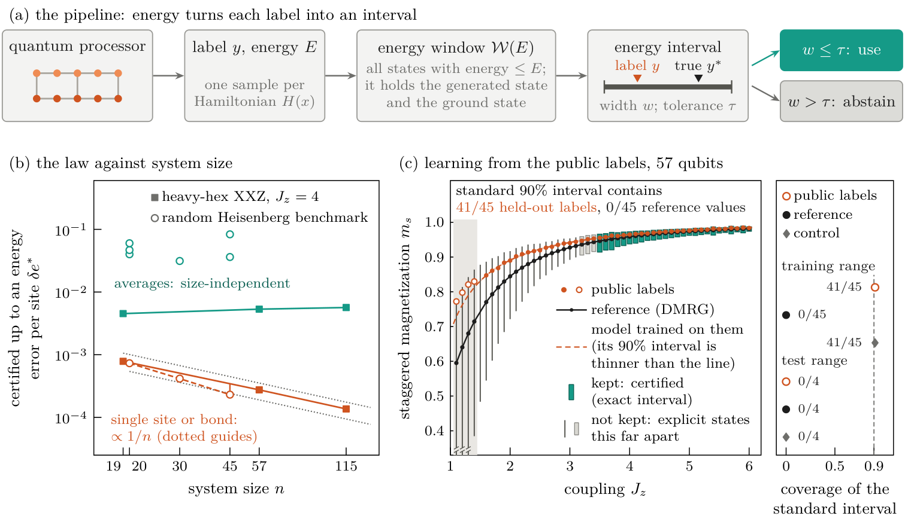

(a) A label's energy fixes an interval that contains the label and its true value; the label is used only if that
interval is at most τ wide. (b) The largest energy error per site at which a label stays certified: flat for
averages, falling as 1/*n* for single sites and bonds. (c) The public labels of the 57-qubit dataset: a cubic model
trained on the 45 training labels follows the labels, not the reference, and misses the reference by 2.28–3.73 τ at
the four test couplings (shaded). Teal bars: the exact intervals of the 26 labels kept by the energy filter; grey
bars: labels not kept. Right: how often the standard interval contains a held-out public label, the reference, and
the reference for a control model trained on DMRG labels.
Vector file: [`fig1_overview_rd_pgf.pdf`](../paper/figures/fig1_overview_rd_pgf.pdf).

### Figure 2. What a sample's energy certifies, and what the first stage of the method class does inside the window (*n* = 57)

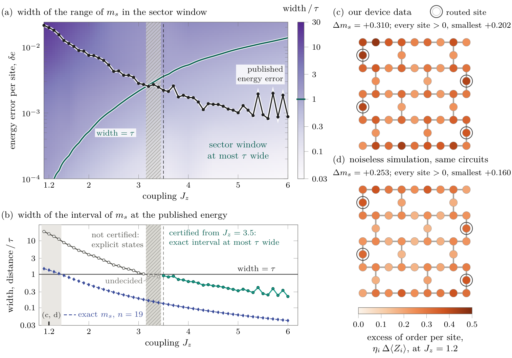

(a) The range of ms allowed by the energy, over the coupling and the energy error per site; below the
teal line the window is at most τ wide. Black line: the published energy error of the dataset at each of its 50
couplings. (b) The width of the interval at the published energy: certified (teal), not certified (dark grey),
undecided (light grey); blue diamonds: how far an exact 19-site calculation, which uses no quantum data, lies from
the reference. (c) Our own device data of the first stage of the method class at Jz = 1.2: the excess of
order is positive at all 57 sites. (d) Noiseless simulation of the identical circuits, again positive at every site.
Vector file: [`fig1_composite_rd_pgf.pdf`](../paper/figures/fig1_composite_rd_pgf.pdf).

### Figure 3. The certification map at the published energies, and the public labels inside it

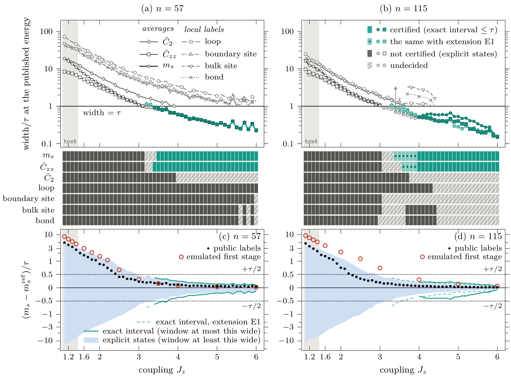

(a, b) Width of each label's interval at the published energy, in units of τ, at every coupling of the dataset, for
*n* = 57 and 115: filled symbols certified (exact interval), open symbols not certified (two explicit states of the
window), light grey undecided; the strips give the status of every label at every coupling. The order parameter is
certified at 26 of the 45 training couplings at *n* = 57 and at 21 at *n* = 115 (27 with the certificates added
afterwards); at the four test couplings (shaded) all seven labels are not certified. (c, d) The interval of
ms and the public labels (dots), as distances from the reference: the public labels lie above the
reference at every coupling of both sizes, and inside the exact interval wherever one exists. Every certified status
rests on the hypothesis that the published energy and labels of a sample belong to one state.
Vector file: [`fig1_map_rd_pgf.pdf`](../paper/figures/fig1_map_rd_pgf.pdf).

### Figure 4. The bias against the energy (exploratory data, with the public labels added)

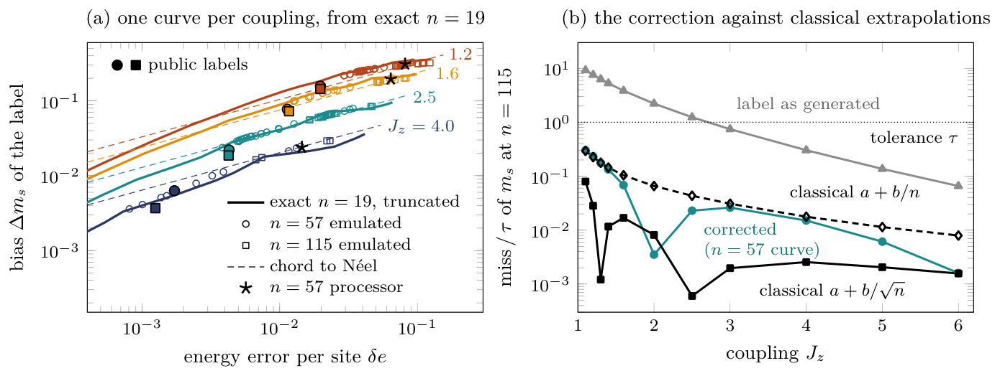

(a) Bias of ms against the energy error per site at four couplings: the exact ground state at *n* = 19
truncated to its most probable configurations (solid), a parameter-free chord between the ground state and the Néel
state (dashed), stored emulated states (open symbols), our device labels (stars) and the public labels (filled). The
declared test of the curve on the public labels fails at *n* = 115. (b) The emulated label at *n* = 115: its miss as
generated, corrected with the curve of the *n* = 57 emulation, and for two classical extrapolations that use no
quantum data.
Vector file: [`fig_bias_law_rd.pdf`](../paper/figures/fig_bias_law_rd.pdf).

## Supplemental Material

### Figure S1. The full certification landscape at *n* = 57 (the map built from the published figures)

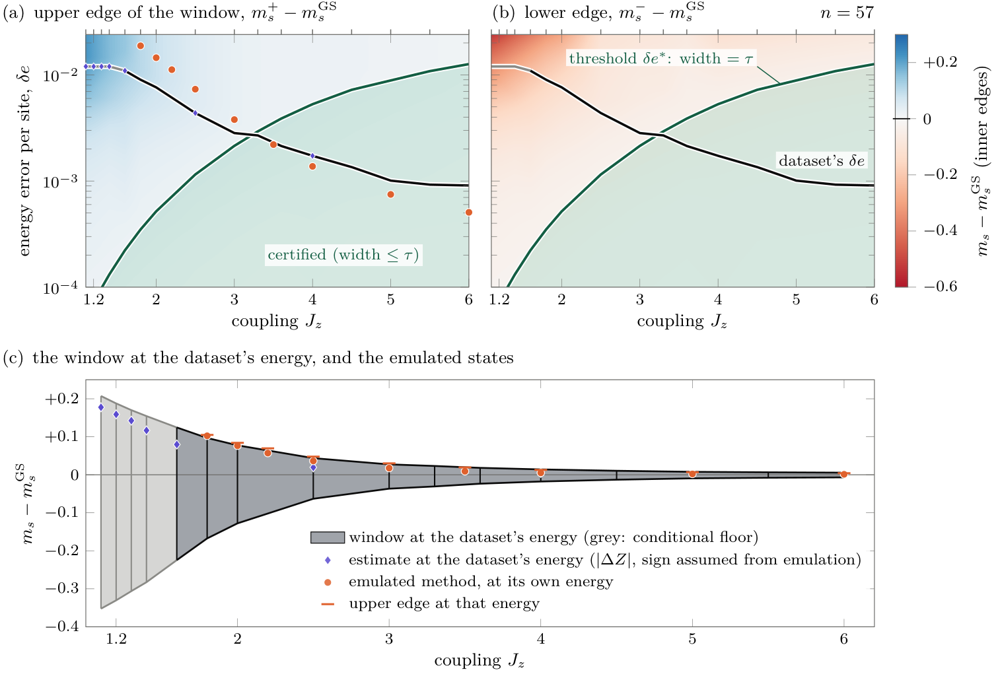

Vector file: [`figS_landscape_n57_pgf.pdf`](../paper/figures/figS_landscape_n57_pgf.pdf).

### Figure S2. Site by site at Jz = 1.2, *n* = 57, on the dataset's heavy-hex lattice

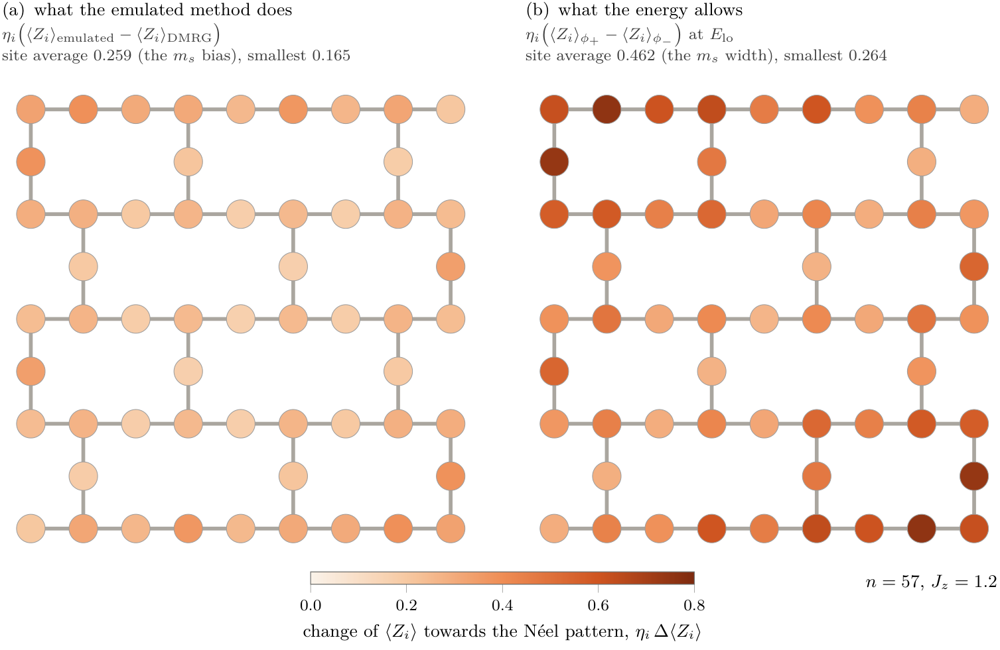

Vector file: [`figS_lattice_pgf.pdf`](../paper/figures/figS_lattice_pgf.pdf).

### Figure S3. Signed bias of ms against the energy ratio, for every emulated family

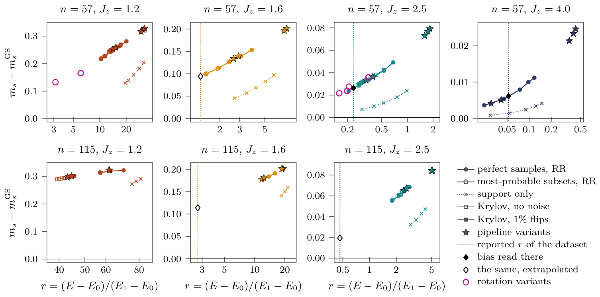

Vector file: [`figS1_bias_vs_ratio_pgf.pdf`](../paper/figures/figS1_bias_vs_ratio_pgf.pdf).

### Figure S4. Learning on the public benchmark (100 instances at *n* = 20, 200 splits)

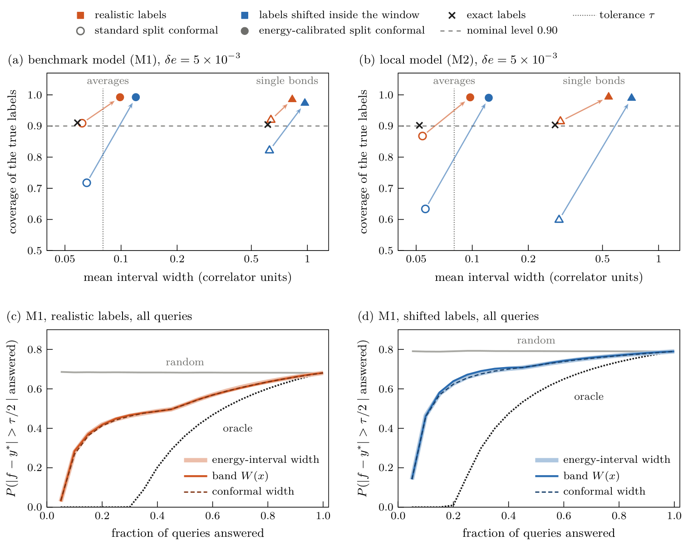

Vector file: [`figS_learning_pgf.pdf`](../paper/figures/figS_learning_pgf.pdf).

### Figure S5. The rule on the second benchmark

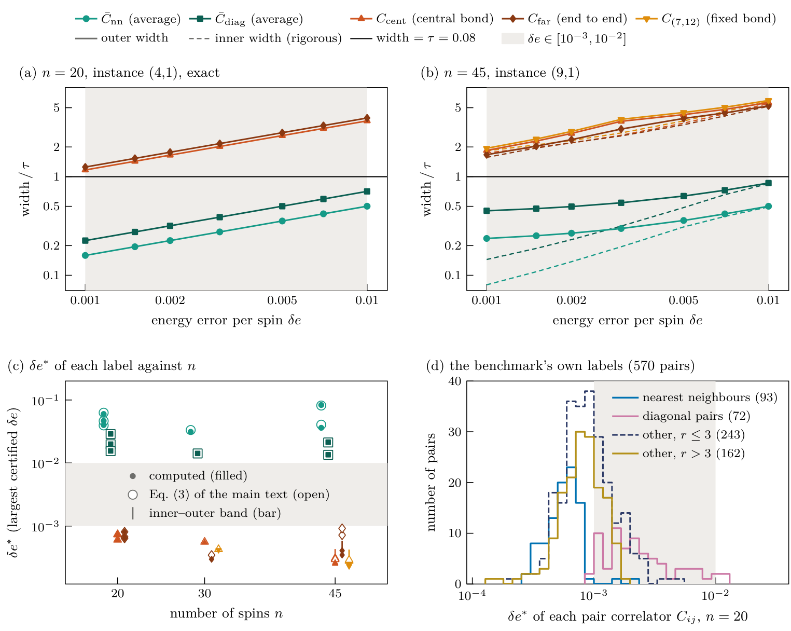

Vector file: [`figS_huang_pgf.pdf`](../paper/figures/figS_huang_pgf.pdf).

### Figure S6. The rule, from exact checks to the dataset

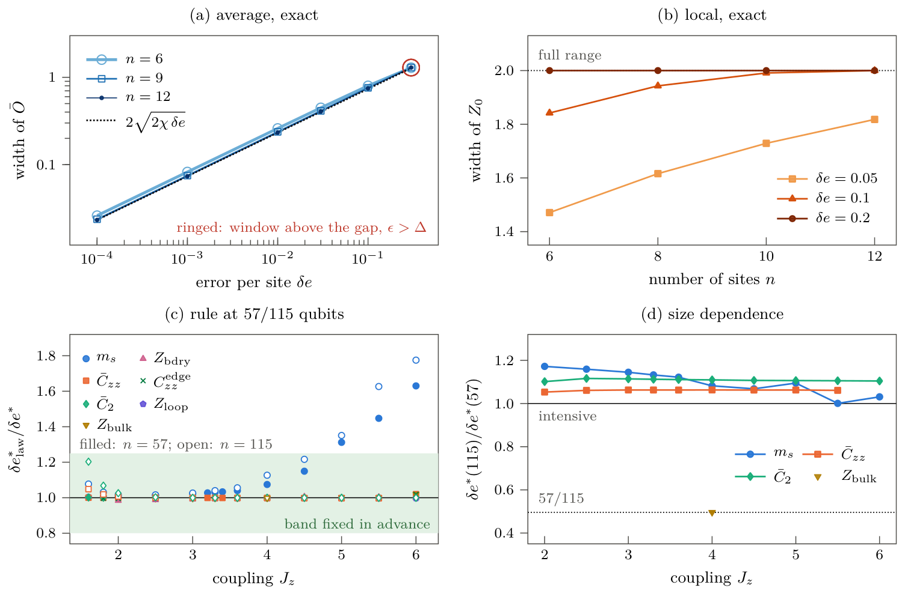

Vector file: [`fig2_rule_pgf.pdf`](../paper/figures/fig2_rule_pgf.pdf).

### Figure S7. Origin of the bias in the emulated first stage of the method class

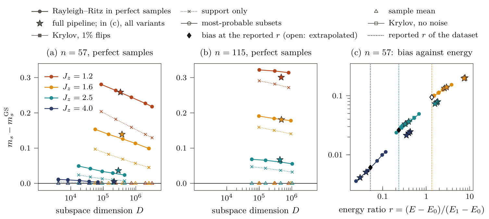

Vector file: [`fig3_mechanism_pgf.pdf`](../paper/figures/fig3_mechanism_pgf.pdf).

## Ancillary tables

### Figure A1. The full certification landscape at *n* = 115

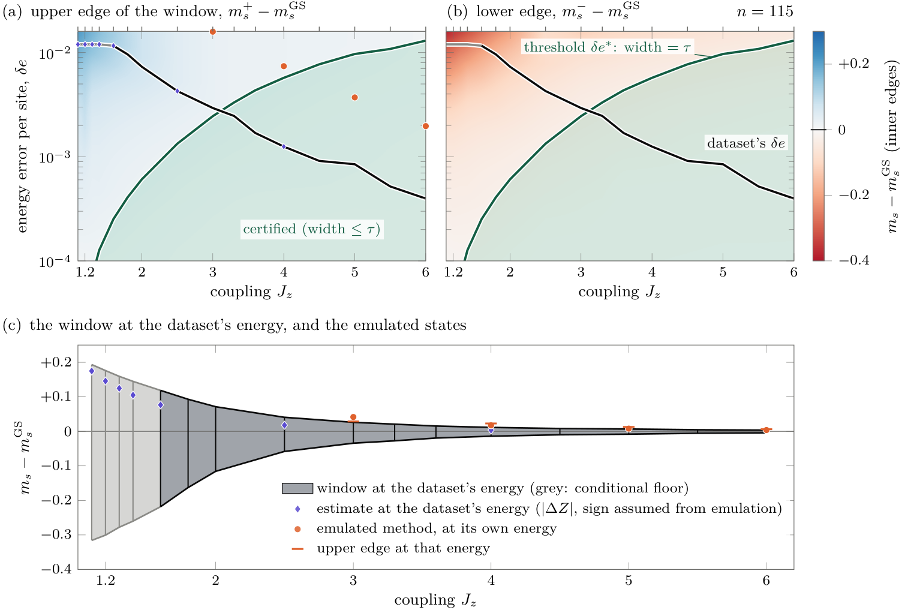

Vector file: [`figS_landscape_n115_pgf.pdf`](../paper/figures/figS_landscape_n115_pgf.pdf).

### Figure A2. Site by site at Jz = 1.2, *n* = 115

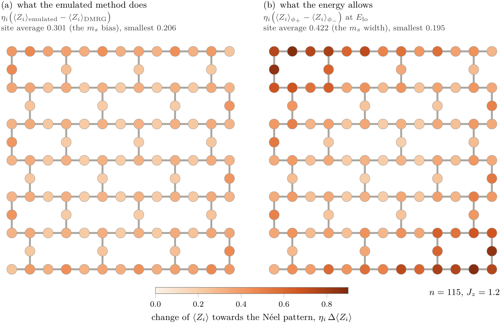

Vector file: [`figS_lattice_n115_pgf.pdf`](../paper/figures/figS_lattice_n115_pgf.pdf).
